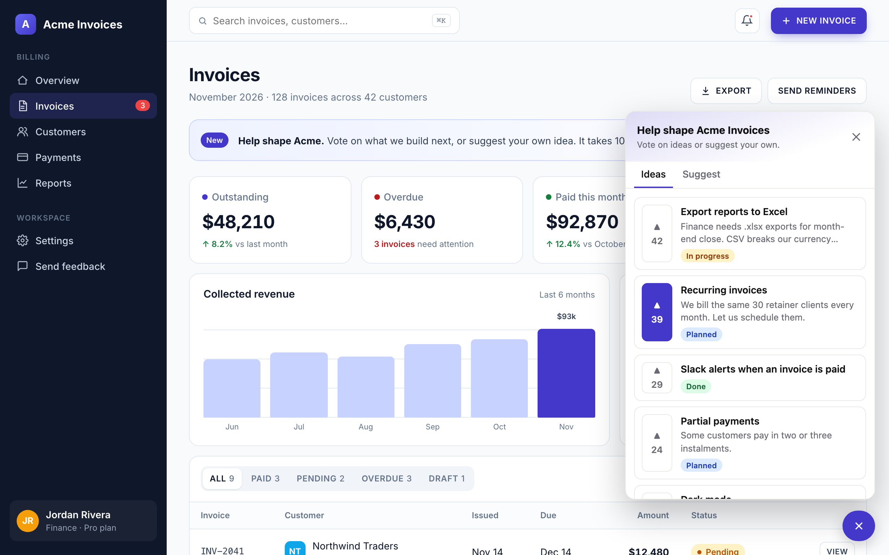
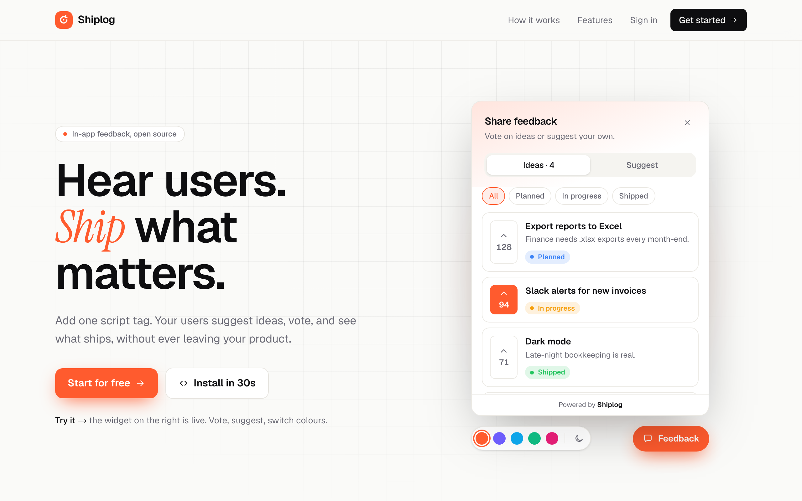
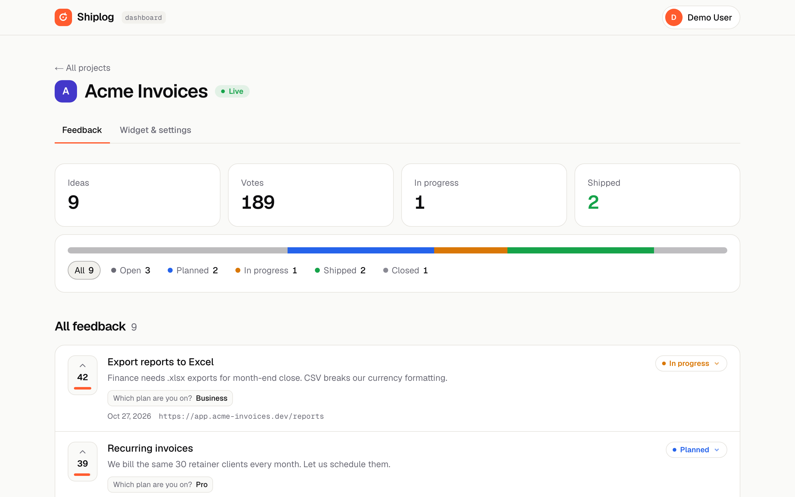
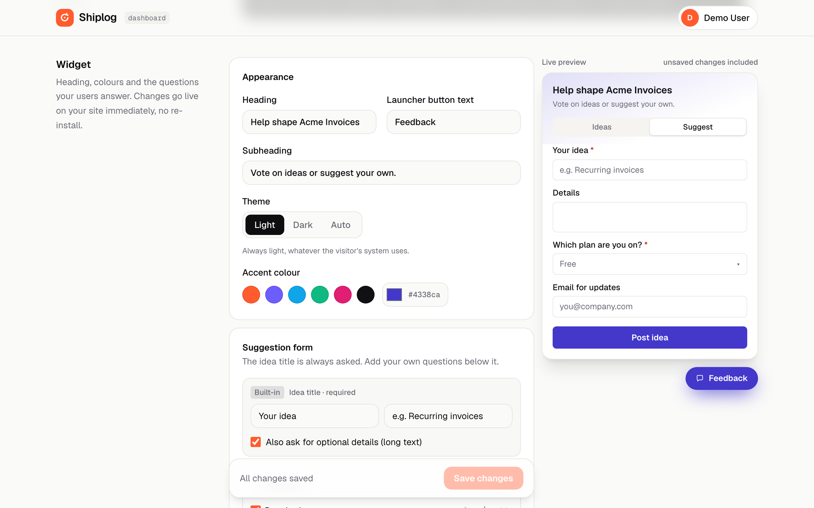
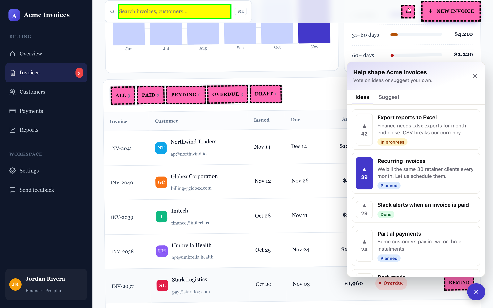
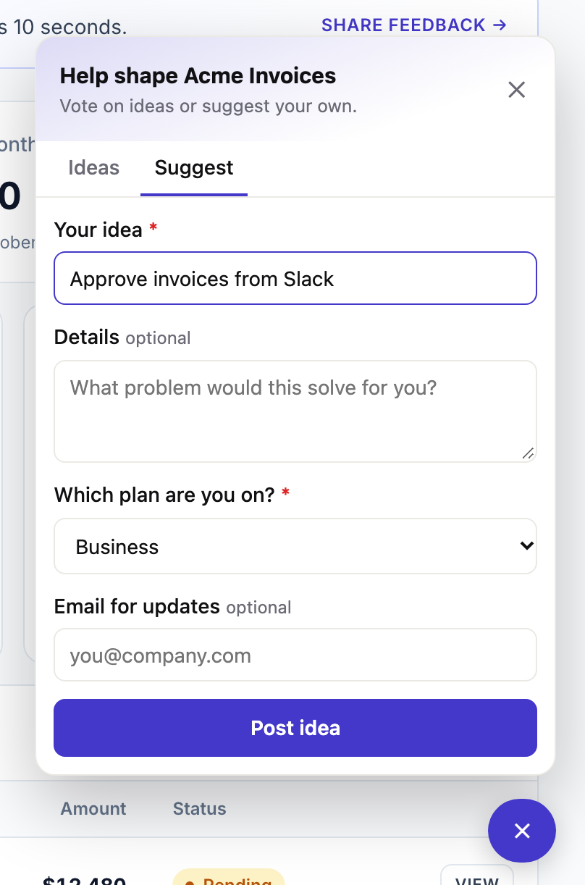

<div align="center">

# Shiplog

**In-app feedback boards that close the loop.**

Add one `<script>` tag. Your users suggest ideas, vote, and see what ships, without leaving your product.




</div>

---

## What it does

Shiplog has two sides:

- **The widget** runs on *your customer's* website. Their users open it, browse ideas ranked by
  votes, upvote the ones they want, and suggest new ones through a form you design.
- **The dashboard** is where you, the product owner, see every request, move ideas through
  `Open → Planned → In progress → Shipped`, and configure the widget. Status changes show up in
  the widget, so users see that you listened.

```html
<!-- That's the whole integration -->
<script src="https://your-shiplog-host/widget.js" data-shiplog-key="pk_..." defer></script>
```

## Features

| | |
|---|---|
| **One-tag install** | No SDK and no build step. Works with React, Vue, Rails, WordPress or plain HTML. |
| **Style isolation** | The widget renders inside a Shadow DOM. Host CSS can't break it, and it can't break the host. |
| **Tiny** | About 10 KB gzipped (Preact). One small config request on page load, and the board loads only when opened. |
| **Custom forms** | Add your own questions (short text, long text, dropdown, email, number), each required or optional. |
| **Branding** | Heading, subheading, launcher text, accent colour and Light / Dark / Auto theme, with a live preview. Changes go live without re-installing. |
| **Optimistic voting** | Votes update instantly. One vote per visitor is enforced by a database unique index, so double clicks and races can't double count. |
| **Access control** | Keys only work from the websites you allow. Keys can be rotated and widgets paused. Writes are rate-limited. |
| **Owner accounts** | Sign up and sign in with sessions stored in Postgres. Every page and action checks that you own the project. |
| **Triage dashboard** | Stats, a status breakdown, filters, custom-field answers on each idea, one-click status changes and spam deletion. |

## Screenshots

<table>
  <tr>
    <td width="50%"></td>
    <td width="50%"></td>
  </tr>
  <tr>
    <td align="center"><b>Landing page</b> with a live, playable widget</td>
    <td align="center"><b>Dashboard</b>: ideas ranked by demand, status changes, custom answers</td>
  </tr>
  <tr>
    <td></td>
    <td></td>
  </tr>
  <tr>
    <td align="center"><b>Widget editor</b>: text, colour, theme and form questions, with a live preview</td>
    <td align="center"><b>Isolation stress test</b>: the host page gets hostile CSS, and the widget is untouched</td>
  </tr>
</table>

<p align="center">
  
  <br />
  <sub>The suggest form, with two custom questions added by the owner</sub>
</p>

## Quick start

**You need:** Node.js 20+ and Docker (for Postgres).

```bash
git clone https://github.com/LitPreet/Shiplog.git
cd Shiplog
npm install                              # installs every workspace

cp apps/web/.env.example apps/web/.env   # local database URL
npm run db:up                            # Postgres 16 in Docker, port 5433
npm run db:migrate                       # create tables
npm run db:seed                          # demo account, project and sample ideas
```

Then run the two dev servers in separate terminals:

```bash
npm run dev:web      # dashboard + API   → http://localhost:3000
npm run dev:widget   # demo customer app → http://localhost:5173
```

### Try it

1. Open **http://localhost:5173**. It's *Acme Invoices*, a demo app with the widget embedded.
   Click **Share feedback →** or the button in the corner. Vote on ideas or suggest one.
2. Open **http://localhost:3000/login** and sign in with the demo account:

   | Email | Password |
   |---|---|
   | `demo@shiplog.dev` | `demo12345` |

3. Change an idea's status (for example, to *Shipped*), then reopen the widget: it shows the change.
4. Go to **Widget & settings**, change the heading, colour or theme, or add a dropdown question,
   then save and refresh the demo app. The widget picks it up without any code change.
5. On the demo app, turn on **Stress test** at the bottom of the page to see Shadow DOM isolation
   in action.

### Add Shiplog to your own site

1. Sign up, then click **New project** and enter your site's domain.
2. In **Widget & settings**, copy the snippet and paste it before `</body>`.
3. Optional: customise the text, colour, theme and questions.

## How it works

```
 Customer's website                              Shiplog (Next.js)
┌──────────────────────────────┐   widget.js    ┌───────────────────────────────────┐
│  <script data-shiplog-key>   │ ─────────────▶ │  /widget.js          static file  │
│                              │                │                                   │
│  #shiplog-root               │   JSON + CORS  │  /api/v1/config      GET          │
│   └─ shadow root             │ ◀────────────▶ │  /api/v1/feedback    GET, POST    │
│       └─ Preact app          │                │  /api/v1/feedback/:id/vote  POST  │
└──────────────────────────────┘                │        │ key + origin + paused?   │
                                                │        ▼                          │
 Site owner                                     │  Prisma ──▶ PostgreSQL            │
┌──────────────────────────────┐ Server         │        ▲                          │
│  /dashboard                  │ Components +   │  session + ownership checks       │
└──────────────────────────────┘ Server Actions └───────────────────────────────────┘
```

- **Widget → API.** The widget calls a versioned REST API (`/api/v1`) across origins. Each request
  carries the project's public key. The server checks the key, that the browser's `Origin` is on
  the project's allowlist, and that the project isn't paused.
- **Dashboard.** React Server Components read from Postgres directly. Changes go through Server
  Actions, and each one checks the session and project ownership first.
- **Custom fields.** The owner's form config is stored as JSON on the project. The widget renders
  it, and the server validates every answer against the same config: required fields, email
  format, and dropdown values limited to the configured options.

More detail, including the data model, the vote transaction and the security model, is in
[docs/ARCHITECTURE.md](docs/ARCHITECTURE.md).

## Security

The widget key is **public by design**, since it sits in the page source. These layers stop it
from being abused:

| Threat | Defence |
|---|---|
| Someone copies your key onto their site | **Origin allowlist.** Browsers set `Origin` themselves, so other sites get `403`. |
| Scripted spam (curl can fake `Origin`) | Per-IP **rate limits** on writes. The key can only list, submit and vote. |
| A leaked key is being abused | **Rotate** the key (the old one stops working immediately) or **pause** the widget. |
| Bad input | **zod** validation on every input. Custom answers are checked against the owner's config. |
| Voting on another project's ideas | Every vote checks that the idea belongs to the key's project. |
| Owner A opening owner B's project | `requireProject()` checks ownership on every page and action, and returns 404 otherwise. |
| Stolen sessions | Random 32-byte tokens in **httpOnly, SameSite=Lax** cookies. Only the token's SHA-256 hash is stored. |
| Password leaks | **scrypt** with a per-user salt and constant-time comparison. Login errors don't reveal which emails exist. |
| Redirect after login to another site | The `next` parameter only accepts paths on this site. |

## Tech stack

| Layer | Technology | Why |
|---|---|---|
| Widget | **Preact**, TypeScript, Vite (library mode, single IIFE file) | It loads on other people's sites, so every KB matters. Preact is about 4 KB compared with about 45 KB for React. |
| Isolation | **Shadow DOM** | Styles are isolated in both directions, without the cost and sizing problems of an iframe. |
| App and API | **Next.js 15** (App Router, Route Handlers, Server Actions) | API and dashboard ship as one app. Server Components query the database directly. |
| Styling | **Tailwind CSS v4** with CSS-variable design tokens | Light and dark themes come from one set of colour tokens. |
| Database | **PostgreSQL 16** + **Prisma** | Relational data, transactions, unique constraints, typed queries and versioned migrations. |
| Validation | **zod** | One schema gives both runtime checks and TypeScript types. |
| Auth | Hand-written sessions, `node:crypto` scrypt | Sessions are stored in the database, so they can be revoked instantly. No auth dependency. |
| Monorepo | **npm workspaces** | One install and one repo for the app and the widget. |

## Project structure

```
shiplog/
├── apps/web/                    Next.js app: dashboard, auth, public API
│   ├── prisma/                  schema, migrations, seed
│   ├── public/widget.js         built widget, served at /widget.js
│   └── src/
│       ├── app/
│       │   ├── (auth)/          login + signup pages and actions
│       │   ├── api/v1/          public widget API (config, feedback, vote)
│       │   ├── dashboard/       projects, feedback triage, settings
│       │   └── page.tsx         landing page
│       ├── components/          shared UI (logo, icons, playground)
│       ├── lib/                 auth, sessions, validation, CORS, rate limits, form fields
│       └── middleware.ts        redirects signed-out users away from /dashboard
├── packages/widget/             the embeddable widget (Preact + Vite)
│   ├── index.html               "Acme Invoices" demo host app
│   └── src/                     App, API client, config, styles
├── docs/                        architecture, roadmap, screenshots
└── docker-compose.yml           local Postgres
```

## API reference

All endpoints need an `X-Shiplog-Key` header and must come from an allowed origin.

| Method | Path | Body | Returns |
|---|---|---|---|
| `GET` | `/api/v1/config` | | Widget text, colour, theme and custom fields |
| `GET` | `/api/v1/feedback?visitorId=…` | | Ideas ranked by votes, each with `hasVoted` for this visitor |
| `POST` | `/api/v1/feedback` | `{ visitorId, title, description?, pageUrl?, answers? }` | The new idea (the submitter's vote is added automatically) |
| `POST` | `/api/v1/feedback/:id/vote` | `{ visitorId }` | `{ voteCount, hasVoted }`. Calling it again removes the vote. |

Error codes: `400` invalid input, `401` unknown key, `403` origin not allowed or project paused,
`404` idea not in this project, `429` rate limited.

## Scripts

| Command | What it does |
|---|---|
| `npm run dev:web` | Dashboard + API on `:3000` |
| `npm run dev:widget` | Demo host app with hot-reloading widget on `:5173` |
| `npm run build:widget` | Builds `widget.js` and copies it to `apps/web/public/` |
| `npm run db:up` / `db:down` | Start or stop local Postgres |
| `npm run db:migrate` | Apply Prisma migrations |
| `npm run db:seed` | Create the demo account, project and ideas (safe to re-run) |

## Roadmap

Done: the core feedback loop, owner accounts, project management, a configurable widget with
custom fields, and themes. Next up: identified users (signed user IDs), "you asked, we shipped"
notifications, AI duplicate merging, end-to-end tests, and deployment. See
[docs/ROADMAP.md](docs/ROADMAP.md).
